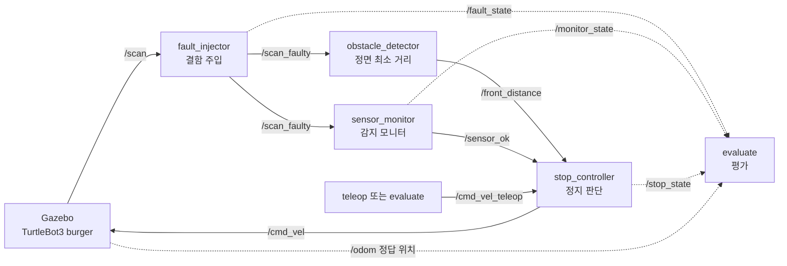

# lidar_safety

TurtleBot3 시뮬레이션
라이다 장애물 인지 → 정지 판단 → 센서 결함 주입 → 감지 모니터 → 자동 평가 
하나로 이은 ROS2 패키지

목표: 센서 데이터 수집, 모델 설계, ROS2 실습을 각각 따로 해 왔던 경험을 한 흐름으로 연결해 보는 것 
> 라이다가 고장 나면 로봇은 어떻게 되고, 그걸 어떻게 막을 수 있는가?


**모니터가 없으면 `zero`·`freeze` 결함 12회가 전부 벽에 충돌했습니다. 모니터를 켜면 결함 5종 30회 모두 충돌 없이, 결함 주입 후 0.1~0.7초 안에 감지하고 섰습니다.** 결함이 없을 때의 정지 동작은 모니터 유무와 관계없이 같았습니다(0.24~0.26m).

---

## 구조



| 노드 | 하는 일 |
|---|---|
| `obstacle_detector` | 정면 ±30° 빔에서 최소 거리를 구합니다. `inf`, `nan`, 측정 범위 밖 값은 "모름"으로 보고 버립니다 |
| `stop_controller` | 사람(또는 평가 스크립트)의 속도 명령을 중간에서 받아, 정면 0.35m 이내이면 전진만 막습니다. 회전과 후진은 허용합니다. 거리값이 0.5초 넘게 끊겨도 섭니다 |
| `fault_injector` | `/scan`에 결함을 섞어 `/scan_faulty`로 내보냅니다. 실행 중에 결함 종류를 바꿀 수 있습니다 |
| `sensor_monitor` | 인지 노드와 **별개로** 원신호를 보고, 믿을 수 없으면 `/sensor_ok=False`를 보내 정지 판단을 덮어씁니다 |
| `evaluate` | Gazebo에 벽을 세우고 결함별 정지/충돌을 반복 측정합니다 |
| `eval_report` | 결과 CSV를 표와 그래프로 정리합니다 |

### 결함 종류

| 결함 | 내용 | 현실에서 비슷한 상황 |
|---|---|---|
| `zero` | 빔을 0.0으로 바꿈 | 유리·검은 면에서 반사가 안 돌아옴, 센서 고장 |
| `noise` | 가우시안 노이즈 (σ=0.05m) | 먼지, 진동 |
| `delay` | 0.8초 늦게 전달 (측정 시각은 원래대로) | 통신·처리 지연 |
| `freeze` | 같은 스캔을 계속 반복 | 드라이버 멈춤 |

### 감지 모니터의 검사 항목

임계값은 정상 시뮬레이션의 `/scan`을 먼저 측정하고 그 위에 여유를 두어 정했습니다.

| 검사 | 정상일 때 측정값 | 이상 판단 기준 | 잡는 결함 |
|---|---|---|---|
| 정면 무효값(0, nan) 비율 | 0% | 30% 초과 | zero |
| 측정 시각의 나이 | ±0.08초 | 0.3초 초과 | delay |
| 메시지 끊김 | 0.2초 간격 | 0.5초 초과 | 통신 단절, 지연 시작 |
| 완전히 같은 스캔 연속 | 0회 (센서 노이즈 σ=0.01 때문에 불가능) | 3회 | freeze |
| 이웃 빔 거리 차이의 중앙값 | 약 0.017m | 0.035m 초과 | noise |

이상이 사라진 뒤에도 정상 스캔이 3번 연속 들어와야 복구합니다. 모니터 자체가 죽어서 소식이 끊겨도 정지 노드는 정상으로 보지 않습니다.

---

## 평가 방법

1. Gazebo 빈 월드에 벽(두께 5cm, 폭 2m)을 세웁니다.
2. 매 시도마다 로봇을 벽 1.3m 앞에 정렬하고 직진시킵니다.
3. 벽까지 **0.8m** 남은 지점에서 주행 중에 결함을 주입합니다.
4. 로봇이 서거나 벽에 닿을 때까지 기록합니다.

- **정답 거리**는 라이다가 아니라 시뮬레이터가 아는 로봇 위치(`/odom`, WORLD 기준)와 벽 위치로 계산한 **로봇 몸체 앞모서리에서 벽면까지의 거리**입니다. 1cm 미만이면 충돌로 봅니다.
- **감지 지연**: 결함 노드가 실제로 결함을 내보내기 시작한 시각부터 모니터가 이상을 알린 시각까지.
- **정지 판단까지**: 같은 시작 시각부터 정지 노드가 정지를 결정한 시각까지. `none`은 결함이 없으므로 0.8m 지점부터 장애물 정지까지의 시간입니다.
- 조건: 결함 5종 × 속도 2개(0.15, 0.22 m/s; 0.22는 burger 최고 속도) × 3회 × 모니터 끔/켬 = **60회**.

## 결과

최종 여유거리(3회 평균)와 충돌 횟수입니다. 결함은 여유거리 0.8m에서 주입했습니다.

| 결함 | 0.15 m/s, 모니터 끔 | 0.15 m/s, 모니터 켬 | 0.22 m/s, 모니터 끔 | 0.22 m/s, 모니터 켬 |
|---|---|---|---|---|
| none | 0.25m | 0.26m | 0.24m | 0.25m |
| delay | 0.15m | 0.71m | **0.06m** | 0.67m |
| zero | **충돌 3/3** | 0.75m | **충돌 3/3** | 0.72m |
| freeze | **충돌 3/3** | 0.67m | **충돌 3/3** | 0.58m |
| noise | 0.34m | 0.74m | 0.30m | 0.71m |

모니터의 감지 지연과 정지 판단까지 걸린 시간입니다(두 속도, 각 6회 평균).

| 결함 | 감지 지연 | 정지 판단까지 | 감지한 검사 |
|---|---|---|---|
| zero | 0.1초 | 0.2초 | 무효값 비율 |
| noise | 0.1초 | 0.2초 | 이웃 빔 차이 |
| delay | 0.4초 | 0.4초 | 메시지 끊김 → 이후 측정 시각의 나이 |
| freeze | 0.7초 | 0.8초 | 같은 스캔 3회 |

시도별 원자료는 [`docs/trials.csv`](docs/trials.csv)에 있습니다. 같은 조건 3회의 최종 여유거리 차이는 20개 조건 중 17개가 3cm 이내였고, 가장 큰 차이는 4.4cm였습니다.

## 해석

**1. 각 노드는 제 할 일을 했는데 시스템은 실패했습니다 (`zero`, `freeze`).**
`zero`에서는 인지 노드가 0을 "모름"으로 버리면서 유효한 빔이 하나도 남지 않았고, 결과로 `inf`("앞이 비었다")를 냈습니다. 정지 노드는 그 말을 믿고 달렸습니다. `freeze`는 더 교묘합니다. 값이 그럴듯하고 메시지도 제때 오니 거리값 끊김 안전장치도 반응하지 않습니다. 둘 다 결과값만 보는 하위 노드로는 잡을 수 없고, 원신호를 따로 보는 모니터가 있어야 잡을 수 있었습니다.

**2. 지연은 "멈추긴 하는데 늦게" 멈춥니다 (`delay`).**
모니터가 없어도 결함이 시작되는 순간의 끊김은 정지 노드의 0.5초 안전장치가 잡아 잠깐 섭니다. 하지만 늦은 데이터가 다시 들어오기 시작하면 정상으로 보고 출발하고, 0.8초 전 거리를 보고 판단하므로 늦게 섭니다. 0.22m/s × 0.8초 ≈ 18cm로, 최고 속도에서는 벽 6cm 앞까지 갔습니다. 모니터는 측정 시각의 나이를 보기 때문에 데이터가 다시 들어와도 늦은 데이터라는 걸 알고 계속 정지를 유지합니다.

**3. 모니터가 "더 안전한" 결과만 내는 것은 아닙니다 (`noise`).**
모니터가 없어도 노이즈 결함은 충돌하지 않았습니다. 오히려 노이즈 때문에 최소 거리가 작게 잡혀 0.30~0.34m에서 일찍 섰습니다. 모니터를 켜면 노이즈를 감지하는 순간 서 버립니다. 안전하지만 로봇이 일을 못 하게 됩니다. 결함 종류에 따라 "정지"가 아니라 "감속"이 맞는 경우가 있고, 그 기준은 현장의 요구에 달려 있습니다.

**4. 감지가 느린 결함일수록 더 들어갑니다 (`freeze`).**
같은 스캔이 3번 반복되어야 판단하므로 0.7초가 걸리고, 0.22m/s에서는 0.58m까지 들어갔습니다. 반복 횟수 기준을 낮추면 빨라지지만, 센서 노이즈가 작은 환경에서는 오경보가 늘어납니다.

---

## 실행 방법

환경: Windows 11 + WSL2 Ubuntu 22.04, ROS2 Humble, Gazebo Classic 11, TurtleBot3 burger

```bash
# 설치
sudo apt install ros-humble-gazebo-ros-pkgs ros-humble-turtlebot3 ros-humble-turtlebot3-simulations
echo 'export TURTLEBOT3_MODEL=burger' >> ~/.bashrc

# 빌드
cd ~/ros2_ws && colcon build --symlink-install && source install/setup.bash
```

**직접 몰아 보기**

```bash
ros2 launch turtlebot3_gazebo turtlebot3_world.launch.py
ros2 launch lidar_safety safety.launch.py                 # monitor:=false 로 끄고 비교
ros2 run turtlebot3_teleop teleop_keyboard --ros-args -r cmd_vel:=cmd_vel_teleop

ros2 param set /fault_injector fault freeze               # none | zero | noise | delay | freeze
ros2 topic echo /monitor_state
```

**평가 재현**

```bash
ros2 launch turtlebot3_gazebo empty_world.launch.py       # 기둥 없는 빈 월드
ros2 run lidar_safety evaluate                            # 약 20분, safety.launch.py는 꺼 둘 것
ros2 run lidar_safety eval_report <결과 폴더>/trials.csv
```

결과 폴더에는 `trials.csv`(시도별 결과), `summary.md`, `clearance.png`, 시도별 상세 기록 `traces/`, 노드 로그가 남습니다.

---

## 만들면서 배운 것

- **측정 도구부터 의심해야 했습니다.** 첫 평가에서는 숫자가 들쭉날쭉했고, 원인은 시스템이 아니라 평가 스크립트에 있었습니다.
  - 기둥이 있는 `turtlebot3_world`에서는 로봇이 벽 대신 옆 기둥에 걸리는 시도가 섞였습니다. → 빈 월드로 옮기고, 로봇 폭의 통로가 비어 있는지 검사한 뒤에 벽을 세우도록 고쳤습니다.
  - 60회 중 5회는 정지 판단 기록이 없는데 로봇이 선 것으로 기록됐습니다. 시도별 상세 기록을 남겨 보니, 노트북 부하로 Gazebo가 실제 시간보다 느려질 때(실시간 배율이 0까지 떨어짐) 실제 시각 기준 제한 시간이 먼저 끝나서, 아직 달리던 로봇을 "멈춤"으로 기록한 것이었습니다. → 제한 시간을 시뮬레이터 시각으로 재고, 시간 초과는 별도 결과로 남기도록 고쳤습니다. 위 결과는 이렇게 고친 뒤 다시 측정한 값입니다.
- **0과 `inf`는 다른 뜻입니다.** Gazebo 라이다에서 `inf`는 "반사 없음(멀다)"이고, 0이나 `nan`은 센서가 낸 오류입니다. 이걸 섞으면 고장을 "장애물 없음"으로 읽게 됩니다.
- **라이다에는 사각지대가 있습니다.** 최소 측정 거리가 0.12m라서, 벽에 닿기 직전에는 라이다가 벽을 보지 못합니다. 정지 거리는 사각지대보다 충분히 커야 합니다.
- **임계값은 정상 데이터를 먼저 재고 정했습니다.** 정상일 때의 노이즈, 측정 시각 오차, 무효값 비율을 측정한 뒤 그 위에 여유를 두었습니다.

## 한계와 다음 단계

- **시뮬레이션만 했습니다.** 실제 센서는 드라이버에 따라 "반사 없음"을 0으로 내기도 하므로, 무효값 검사는 실센서에 맞게 다시 정의해야 합니다. 노이즈와 시각 오차 임계값도 실센서 데이터로 다시 측정해야 합니다.
- **시나리오가 하나입니다.** 정면의 고정된 벽, 직진, 하나의 정지 거리만 다뤘습니다. 비스듬한 접근, 움직이는 장애물, 일부 빔만 고장 나는 경우(`zero_ratio` < 1)는 아직 평가하지 않았습니다.
- **모니터의 대응이 "정지" 하나뿐입니다.** 결함 종류별로 감속이나 안전 모드를 두는 것이 다음 단계입니다.
- 다음에 해 볼 것: 공개 실센서 데이터(rosbag) 재생, 속도에 따라 정지 거리를 바꾸는 정지 판단, 부분 결함 평가.
