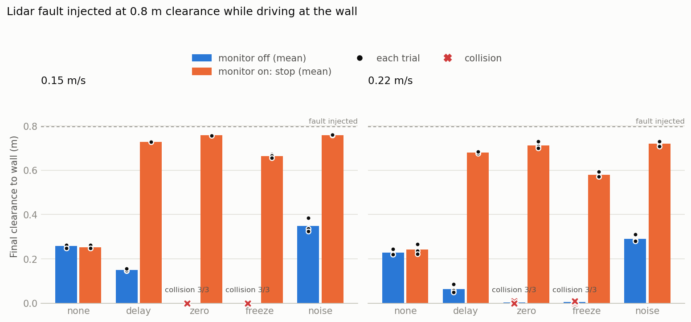

# 라이다 결함 주입 평가 결과

시도 60회. 벽까지 여유거리 약 0.8m 지점에서 주행 중 결함을 주입했다. 여유거리는 로봇 몸체 앞모서리에서 벽면까지의 실제 거리(시뮬레이터 정답)다. 결함 none은 주입 시점부터 장애물 정지까지의 시간을 정지 판단 시간으로 적었다.

| 결함 | 속도 | 모니터 | 충돌 | 최종 여유거리 평균 (최소) | 감지 지연 평균 | 결함 후 정지 판단까지 평균 |
|---|---|---|---|---|---|---|
| none | 0.15 m/s | off | 0/3 | 0.26 m (0.25) | - | 3.50 s |
| none | 0.15 m/s | on | 0/3 | 0.25 m (0.25) | - | 3.50 s |
| delay | 0.15 m/s | off | 0/3 | 0.15 m (0.15) | - | 0.40 s |
| delay | 0.15 m/s | on | 0/3 | 0.73 m (0.73) | 0.40 s | 0.40 s |
| zero | 0.15 m/s | off | **3/3** | 0.00 m (0.00) | - | - |
| zero | 0.15 m/s | on | 0/3 | 0.76 m (0.76) | 0.10 s | 0.20 s |
| freeze | 0.15 m/s | off | **3/3** | 0.00 m (0.00) | - | - |
| freeze | 0.15 m/s | on | 0/3 | 0.66 m (0.66) | 0.70 s | 0.80 s |
| noise | 0.15 m/s | off | 0/3 | 0.35 m (0.32) | - | 2.90 s |
| noise | 0.15 m/s | on | 0/3 | 0.76 m (0.76) | 0.10 s | 0.20 s |
| none | 0.22 m/s | off | 0/3 | 0.23 m (0.22) | - | 2.43 s |
| none | 0.22 m/s | on | 0/3 | 0.24 m (0.22) | - | 2.43 s |
| delay | 0.22 m/s | off | 0/3 | 0.06 m (0.05) | - | 0.40 s |
| delay | 0.22 m/s | on | 0/3 | 0.68 m (0.68) | 0.40 s | 0.40 s |
| zero | 0.22 m/s | off | **3/3** | 0.00 m (0.00) | - | - |
| zero | 0.22 m/s | on | 0/3 | 0.71 m (0.70) | 0.10 s | 0.20 s |
| freeze | 0.22 m/s | off | **3/3** | 0.01 m (0.00) | - | - |
| freeze | 0.22 m/s | on | 0/3 | 0.58 m (0.57) | 0.70 s | 0.80 s |
| noise | 0.22 m/s | off | 0/3 | 0.29 m (0.28) | - | 2.10 s |
| noise | 0.22 m/s | on | 0/3 | 0.72 m (0.71) | 0.10 s | 0.20 s |
